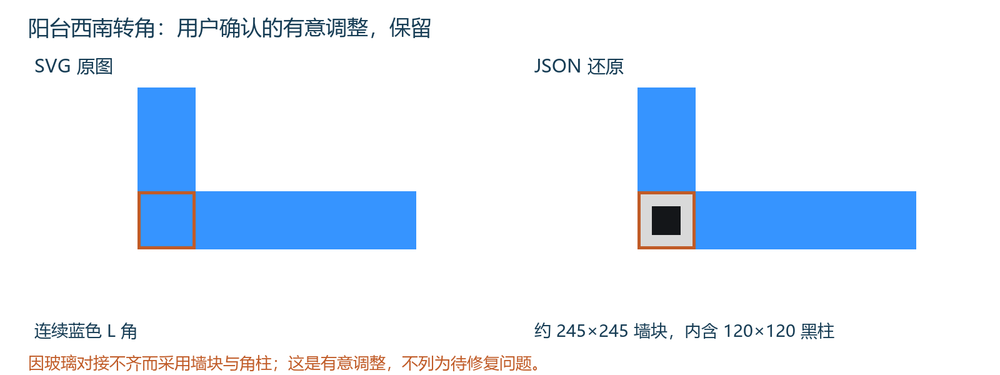
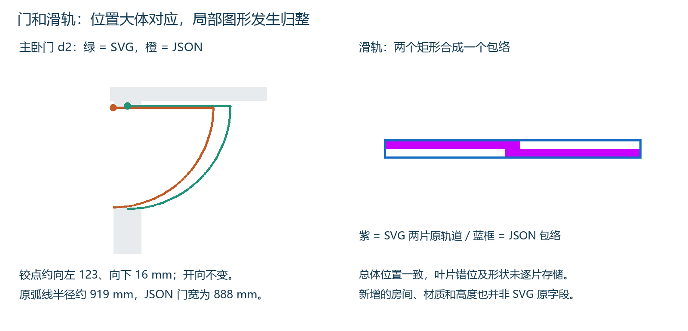

# SVG 与 JSON 差异核对

核对日期：2026-10-21。只以 `../../samples/reference/户型.svg` 为平面几何基准，对照 `../../samples/我的改图_对比基线.json`。本报告替代此前报告的比较重点；不把原始 PDF 的尺寸差当成 SVG 转换差异。

**结论：原有 42 段墙没有丢失或移位。阳台 L 角采用墙块与角柱，是用户为解决玻璃对接不齐而有意做的调整，予以保留，不列为还原错误或待修复项。其余可见差异是 5 扇门铰点/扇宽归整，以及滑轨两片合为包络。**

2026-10-21 用户补充确认：“阳台是因为玻璃对不上我故意这么做的”。本版据此修订，撤销此前恢复连续玻璃的建议。

| 项目 | SVG | JSON | 判定 |
| --- | --- | --- | --- |
| 墙体 | 42 段（18 黑、24 灰） | 原 42 段 + 新增 w42/w43 = 44 段 | 原墙坐标和黑/灰对应属性 42/42 一致，无原墙增厚、缩短、移位 |
| 窗 | 9 段蓝色矩形 | 9 段 | 8 段边界完全对应；win1 南端缩短 245 mm |
| 阳台转角 | 32×32 SVG 单位的蓝色玻璃角 | 约 245×245 实体角块，内部 120×120 黑柱 | 用户确认的有意调整：解决玻璃对接不齐，保留 |
| 平开门 | 5 扇橙色扇形 | 5 个门对象 | 5/5 关闭方向、开启方向一致；铰点和扇宽均非原坐标直接复制 |
| 滑轨 | 2 片错位紫色矩形 | 1 个 s0 总包络 | 位置/包络一致，逐片形状未保留 |
| 房间 / 高度 / 材质 | SVG 未定义 | 6 区域及名称、材质、层高、窗种类等 | 生成或补充数据，不属于可直接核对的 SVG 原字段 |

## 1. 坐标统一后再比较

当前转换相当于 x_mm = 7.649315068493 × x_svg -1471.539726027397，y_mm = 7.654347826087 × y_svg -1081.978260869565，矩形边界取整到 mm。42 段墙用同样变换后逐坐标比较，差值全部为 0；实际取整误差相对未取整值至多约 0.5 mm。

x/y 比例相差约 0.0658%，因此是轻微非等比例换算。SVG 本身没有 mm 单位标尺；本次只评价几何保留程度，不对该绝对毫米标定值是否正确下结论。

## 2. 阳台 L 角：已确认的有意调整

- SVG 西侧竖窗原矩形：`[585,1276,617,1490]`，完整覆盖西南角 `[585,1458,617,1490]`；南侧横窗从 x=617 开始与它拼成连续蓝色 L 形。
- 原竖窗换算后应为 `[3003,8685,3248,10323]`；JSON win1 实际为 `[3003,8685,3248,10078]`，南端向上缩短 245 mm。
- 新增 w42：`[3003,10078,3248,10323]`，即约 245×245 的灰色实体角块。
- 新增 w43：`[3066,10140,3186,10260]`，120×120 黑色角柱，完全处在 w42 内。黑柱不再额外向外扩大外轮廓。
- 南窗 win3 仍为 `[3248,10078,9788,10323]`，其边界本身没变化；变化发生在它左侧的原蓝色转角。

**几何记录仍保留，但判定改为有意调整。** 用户已在本次对话明确说明，为解决玻璃对接不齐而采用墙块和角柱。保留当前阳台处理，不把它列为转换错误，不再建议恢复连续玻璃。

## 3. 其他 8 段窗逐坐标一致

| 窗 ID | SVG 按比例换算的矩形 mm | JSON 矩形 mm | 边界差值 |
| --- | --- | --- | --- |
| win0 | [724, 8440, 2759, 8685] | [724, 8440, 2759, 8685] | [0, 0, 0, 0] |
| win1 | [3003, 8685, 3248, 10323] | [3003, 8685, 3248, 10078] | [0, 0, 0, -245] |
| win2 | [3202, -240, 3990, 5] | [3202, -240, 3990, 5] | [0, 0, 0, 0] |
| win3 | [3248, 10078, 9788, 10323] | [3248, 10078, 9788, 10323] | [0, 0, 0, 0] |
| win4 | [5038, -240, 6637, 5] | [5038, -240, 6637, 5] | [0, 0, 0, 0] |
| win5 | [7754, -240, 8549, 5] | [7754, -240, 8549, 5] | [0, 0, 0, 0] |
| win6 | [9153, -240, 11150, 5] | [9153, -240, 11150, 5] | [0, 0, 0, 0] |
| win7 | [11089, 8440, 13032, 8685] | [11089, 8440, 13032, 8685] | [0, 0, 0, 0] |
| win8 | [12114, 388, 12917, 633] | [12114, 388, 12917, 633] | [0, 0, 0, 0] |

这里不再把主卧南窗较原始 PDF 变宽等问题列为 SVG→JSON 差异：它们在本次 SVG 与 JSON 之间是相符的。

## 4. 门：没有开反，但没有逐坐标复制

| 门 | SVG 原铰点（SVG 单位） | JSON 铰点反算回 SVG | 铰点位移（mm，右/下为正） | SVG 原关闭半径 → JSON 门宽 mm | 开/关方向 |
| --- | --- | --- | --- | --- | --- |
| d0 入户门 | (450, 577) | (447.95, 591.95) | (-15.7, +114.4) | 917.9 → 887 | 一致 |
| d1 西南卧室门 | (579, 780) | (576.98, 788.05) | (-15.4, +61.6) | 917.9 → 887 | 一致 |
| d2 主卧门 | (1488, 598) | (1471.97, 600.05) | (-122.6, +15.7) | 918.5 → 888 | 一致 |
| d3 卫生间门(东) | (1758, 584) | (1758.01, 591.95) | (+0.0, +60.8) | 742.0 → 734 | 一致 |
| d4 北卧室门 | (1373, 584) | (1374.05, 591.95) | (+8.0, +60.8) | 734.3 → 719 | 一致 |

比较的是 SVG 可见门扇扇形的中心及半径，与 JSON 的 hinge / width / closeDir / openDir。SVG 没有独立的门洞矩形字段，因此“SVG 半径”和“JSON 门洞/门扇宽度”不是天然相同的字段；表中的差值描述图形归整程度，不自动判定为建模错误。

原图多扇门铰点画在墙中或门弧交点，JSON 将它归整到洞口端角 / 墙面。主卧门位移约 124 mm、入户门约 115 mm、其余约 61~63 mm。空间位置和开向对应，若要求逐图一致，这些细节也需恢复。

应用外观另有一项差别：SVG 是橙色扇形填充和弧线；JSON 保存门参数而非原 SVG path。当前 index.html 的 2D renderOpenings 只画门扇矩形，不画原扇形弧线。这是显示方式差异，不能称为 JSON 中整扇门丢失。

## 5. 滑轨：一个包络替代两片矩形

- SVG 第一片 `[1136,339,1250,347]`，换算为 `[7218,1513,8090,1574]`；第二片 `[1238,347,1352,355]`，换算为 `[7998,1574,8870,1635]`。
- JSON 只保存 s0 总包络 `[7218,1513,8870,1635]`，横向 1652、纵向 122 mm。包络边界与源图一致。
- 两片原轨道位置、厚度与相互错位没有逐片保存在 JSON。总矩形中的空白不应当作新加实墙；它是门对象的包络。
- 当前工具 2D 会按总长 55% 重建两扇门片，单片 908.6×40 mm；SVG 换算后单片约 872×61 mm。因此整体位置不变，但显示形状也有简化。此项由源码确认，未运行浏览器复验。

## 6. 自动添加内容与几何差异分开看

JSON 的 6 个房间多边形、名称、材质、labelAt、floorElevation，以及层高、窗台和窗高，均不是本 SVG 直接提供的属性。房间连通区域反映手改图现状，但地板边界还做了外扩，不能称为逐像素提取的原 SVG 封闭面。

前报告中的外墙属性漏标和面积口径仍是后续可修的数据问题；它们不是“SVG 原墙位置被移动”，也不影响本次确认的 42 段原墙保留结论。

## 7. 针对本次问题的处理建议

1. 原有 42 段墙及其余 8 段窗可保留，不需要按原始 PDF 重新画它们。
2. 保留当前阳台墙块与角柱，这是用户已明确确认的有意调整。
3. 再决定门是否按 SVG 原铰点、原半径复制，以及滑轨是否逐片保存。
4. 自动房间/高度/材质与 SVG 几何还原分开验收。

本报告对应分格修改前的对比基线。之后生成的阳台大玻璃最新版见 ../../samples/我的改图_阳台大玻璃.json；阳台有意调整继续保留。

| 源文件 | SHA-256 |
| --- | --- |
| C:\Users\LQT15\Desktop\户型.svg | b6da843087ad325310f49215bca6bc92fc3b07c41b3623b48778d6f4dc9f9691 |
| C:\Users\LQT15\Desktop\我的改图_导出.json | 08715edb406eba271348665efa9593e4400dd2da8f97d0c0b5e631309c334ff1 |
