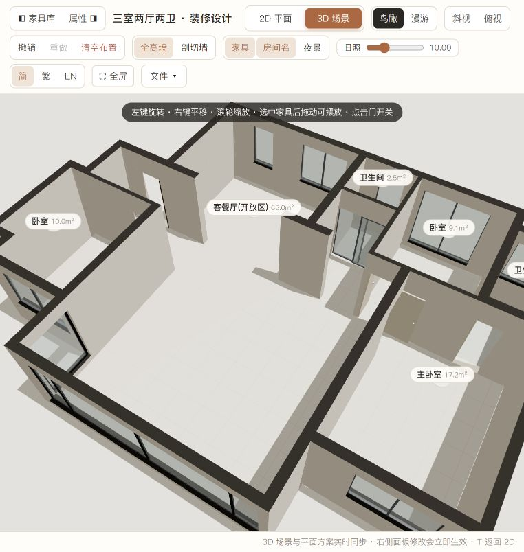

# JSON 规范修复结果

日期：2026-10-22。当前成品：`samples/我的改图_阳台大玻璃.json`。

**已清除房间轮廓冗余并修正外围墙类别，当前页面已导入新版，39 项测试通过。**

| 项目 | 修复前 | 修复后 |
| --- | ---: | ---: |
| 房间顶点记录 | 174 | 70 |
| 相邻重复点 / 零长度边 | 52 | 0 |
| 去重后的共线中间点（包含折返） | 52 | 0 |
| 客餐厅共线反向折返 | 2 | 0 |
| 外围候选墙误标为 interior | 14 | 0 |
| 以上外围墙被软件允许拆除 | 7 | 0 |
| 导入错误 / 警告 / 缺省补值 | 0 / 0 / 0 | 0 / 0 / 0 |
| 六房间净面积 | 107.604227 m² | 107.604227 m² |

## 修改范围

房间仅删除相邻重复点及共线冗余，包含零面积折返；每个保留顶点仍使用原始坐标。各房间顶点数为 R01 26、R02 10、R03 12、R04 4、R05 6、R06 12。

下面 14 段墙的 `kind` 从 `interior` 改为 `exterior`：

`w1、w7、w9、w10、w17、w21、w22、w23、w24、w25、w26、w27、w31、w33`。

判定依据为墙体与封闭平面外部连通区域的接触关系。所有墙体的矩形、编号、`bearing` 承重属性均保持原值；普通内墙的编辑能力保留。外墙在 2D 中按既有外墙样式显示。

门窗、窗高、铰点、门宽、材质、标高、房间名称与标注点均保留。已确认的阳台角墙/角柱包含关系和北侧墙接头搭接继续保留；原地板覆盖范围与墙内净轮廓的区分也继续保留。

## 验证

- 严格 JSON、编号、字段、材质引用及高度检查通过。
- 导入再导出，原文件字段没有丢失或数值变化。
- 按修复前后全部顶点坐标划分实际区域，逐单元比较每个房间的覆盖状态，完全一致；各房间原覆盖面积及净面积分别一致。
- 修复后相邻重复点、共线点、反向折返和外围类别漏标均为 0。
- 净区域重叠、封闭室内漏铺、地板越出封闭平面的面积均为 0。
- 14 段外围墙全部禁止软件拆除；在页面拆墙工具中点击原可拆的 `w25`，提示“外墙属于建筑外围护结构，不可拆除”。
- 当前页面导入新版后恢复方案，修复前后导出的材质、家具、测量及拆墙状态逐字一致。
- 2D/3D 正常；窗型、阳台玻璃分格、三卧室门洞通铺规则均保留。
- 39 项 Node 测试通过；再次执行规范化得到相同数据，无进一步变化。

## 文件与复现

- 成品：`../../samples/我的改图_阳台大玻璃.json`，此前交付的 `.private.json` 本机副本已同步。
- 修复前快照：`JSON规范修复前.json`。
- 修改清单：`JSON规范修复-变更.json`。
- 修复前审计数据：`JSON规范性检查-修复前数据.json`。
- 当前审计数据：`JSON规范性检查-数据.json`。
- 显式规范化工具：`tools/normalize_floorplan.py`；SVG 转换脚本输出前已调用该工具。该步骤不在导入适配器中自动执行，保持导入时不修改用户原始几何的约定。
- 当前成品 SHA-256：`e0fb086c23ef3a3df41eb4666bdb3c9f4c6872a0e1d1c76a3a834da76d5763a3`。

