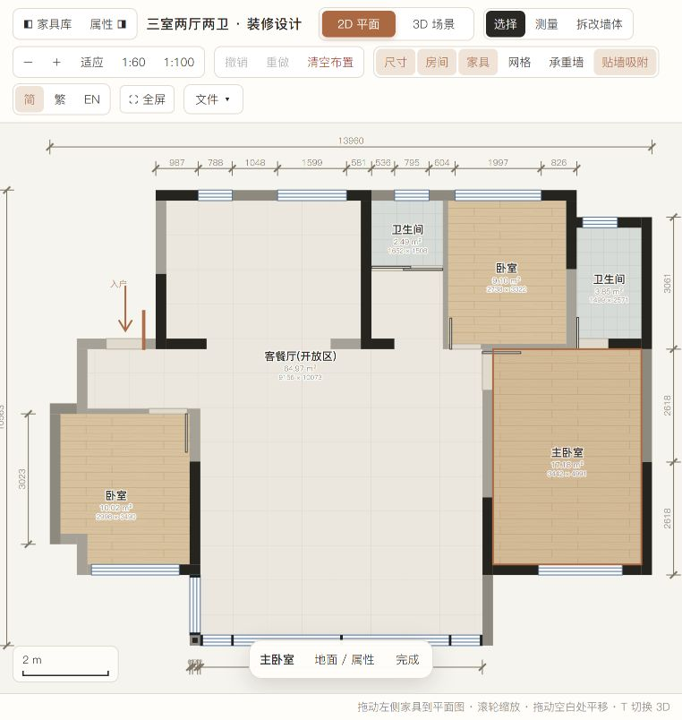
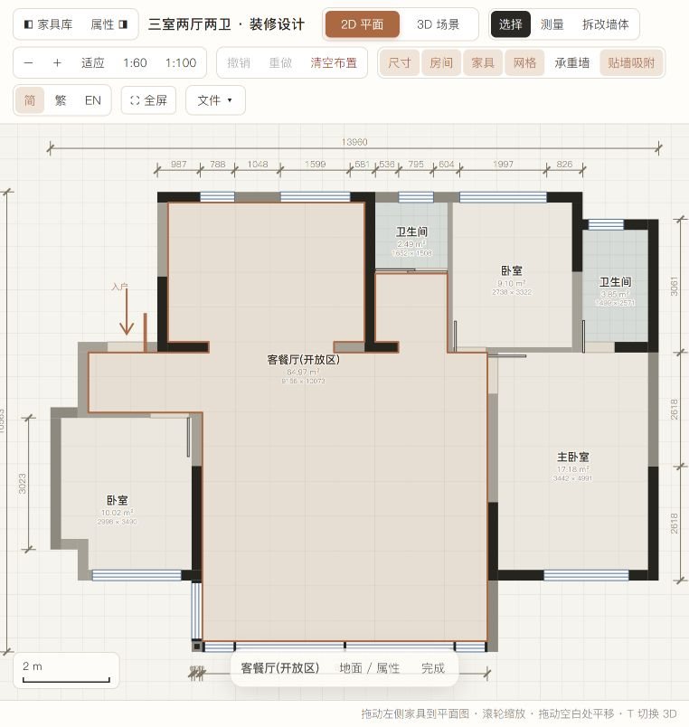

# 房间选中边线与净面积修正

日期：2026-10-22

原房间 polygon 用于覆盖墙根白缝，包含约 100 mm 的墙下延伸。此前选中线、拾取、尺寸和面积直接使用该 polygon，导致边线落在不同深度的墙体内。

本次新增 `FPCore.roomInterior(model, room, demolished)`，根据原房间多边形减去现存墙体、窗带、门洞及推拉门槛占地，派生净轮廓。选中线和 2D 拾取使用净轮廓；2D/3D 面积、开间进深、周长及材料估算统一使用相应净数据。原 polygon 继续用于 2D/3D 地板覆盖，导入、导出和存档不改写建筑坐标。

当前模型 `samples/我的改图_阳台大玻璃.json` 的六个净面积：

| 房间 | 净面积 m² | 净边界包围尺寸 mm |
| --- | ---: | --- |
| 客餐厅（含连通开放区） | 64.967828 | 9156 × 10073 |
| 北侧卫生间 | 2.491216 | 1652 × 1508 |
| 北侧卧室 | 9.095636 | 2738 × 3322 |
| 东侧卫生间 | 3.853929 | 1499 × 2571 |
| 主卧室 | 17.179022 | 3442 × 4991 |
| 西南卧室 | 10.016596 | 2998 × 3490 |
| 合计 | 107.604227 | |

凹形房间的面积按轮廓计算，包围尺寸不能直接相乘作为面积。以上为当前模型的计算值。

验证：36 项 Node 测试通过，覆盖墙/窗/门/推拉门、重复及重叠墙块、洞、分离区域、斜边、反向顶点、真实六房间和原始几何不变。浏览器逐一点击六个房间核对边线与面板尺寸，重载恢复当前模型，3D 净面积同步。墙根地板覆盖和已确认阳台玻璃分格保持原样。

